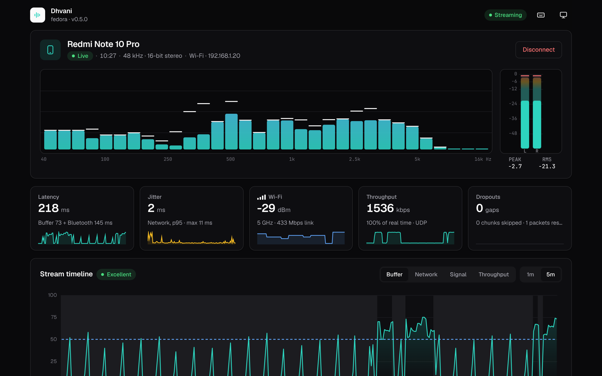

# Dhvani



Plays your Android phone's audio on your Linux laptop over Wi-Fi: music, videos, games. Only playback audio is sent, never the microphone or the screen. A free, open alternative to AudioRelay for Android to Linux (PipeWire).

## Quick start

1. On the laptop: `git clone https://github.com/Snehit70/dhvani && cd dhvani && ./install.sh`, then open <http://127.0.0.1:47801>.
2. On the phone: install `dhvani.apk` from the [latest release](https://github.com/Snehit70/dhvani/releases/latest).
3. Open Dhvani on the phone, tap your laptop, enter the 6-digit code from the panel, tap **Start streaming**.

## How it works

```
phone (Android 10+)  --UDP 47802, raw 48 kHz stereo PCM, each packet sent twice-->  laptop (PipeWire)
                     <--TCP 47800 pairing, laptop volume, keepalive-->
                     <--UDP 47802 discovery and phone reports-->
```

Over Wi-Fi the audio goes as 5 ms UDP packets, each one sent again 20 ms later. A lost
packet is filled from its copy, and one lost twice is covered by a 5 ms fade, so it is heard
as a dip rather than a click. Over TCP the same loss stalled the stream for one to three
seconds while the packet was resent. If UDP does not get through, the laptop asks the phone
to send on the TCP socket instead, and switches back to UDP once the phone's reports reach it
again (phone app 0.7+). Over USB (`adb reverse` carries TCP only) audio always uses TCP.

## Laptop

Needs Linux with PipeWire (`pw-cat`, `pactl`) and [Bun](https://bun.sh).

```sh
./install.sh      # builds, installs ~/.local/bin/dhvani, starts a systemd user service
./uninstall.sh
```

The control panel is at <http://127.0.0.1:47801> (also "Dhvani" in the app menu). There you can:

- pick the output (follow the system output, Bluetooth headset, speakers), set volume up to 150%, and mute.
  The volume follows the same curve as the system volume (50% is about -18 dB, 150% about +10 dB),
  so each step sounds about the same size anywhere on the slider
  If a chosen headset switches off or leaves range, Dhvani plays silence instead of falling back
  to the speakers, and resumes when it comes back
- see the pairing code, make a new one, and see the laptop's addresses
- check health (server, discovery, firewall) and disconnect the phone

Settings are in `~/.config/dhvani/config.json` (mode 600).

The firewall must allow 47800/tcp and 47802/udp. On Fedora:

```sh
sudo firewall-cmd --permanent --add-port=47800/tcp --add-port=47802/udp && sudo firewall-cmd --reload
```

Logs: `journalctl --user -u dhvani -f`

## Phone

Get `dhvani.apk` from [Releases](https://github.com/Snehit70/dhvani/releases/latest), or build it:

```sh
android/build.sh   # -> android/dist/dhvani.apk, about 40 KB; no Gradle
```

Building needs only an Android SDK (platform + build-tools) and a JDK 17+.

1. Install the APK, open Dhvani.
2. Tap your laptop in the list or type its IP, then enter the 6-digit code from the panel.
3. Tap **Start** and allow the sharing prompt.

Options:

- **Silence this phone**: mutes the phone speaker while streaming and restores it when you stop, or 10 s after the connection drops (so a quick reconnect is not heard on the phone). Some phones also mute the shared audio when the speaker is muted. Dhvani detects that after about 3 s of silence, puts the volume back, and tells you to turn the option off.
- **Volume buttons control the laptop**: while the phone is silenced, its volume buttons change the laptop volume (5% a press, with a short on-screen note) and the phone stays quiet. This uses a small Accessibility service that only looks at the volume keys, and only while streaming. Turn on **Dhvani volume buttons** in Accessibility settings. On Android 13+ a sideloaded app's toggle is greyed out until you allow it: App info, ⋮ menu, **Allow restricted settings**. Without the service, Dhvani still catches the phone volume rising, puts it back to 0 within a moment and moves the laptop up one step instead, but a press can be heard briefly and volume down can't be seen.
- **Wi-Fi tips**: while streaming, the app tells you when the phone is on 2.4 GHz or has a weak signal, the usual causes of dropouts.
- **Reconnect automatically**: retries with backoff if Wi-Fi drops or the laptop restarts.
- **Start when opened**: opening Dhvani connects to the saved laptop right away.

The laptop and code are remembered, so you pair once. Android still shows the
"allow sharing" prompt at every start; apps cannot skip it.

While streaming, the app shows a **Laptop volume** slider and mute button that
change the laptop's own output. The notification has **Stop** and **Mute laptop**.

Add the **Dhvani** Quick Settings tile (edit the quick settings panel) to start
or stop from anywhere.

During long digital silence the phone sends only a short keepalive four times a
second, so the Wi-Fi radio can rest. The laptop counts that as idle, not as
network gaps.

**USB cable:** turn on USB mode in the laptop panel with `adb` installed and USB
debugging on. The phone then lists the laptop as "USB cable". Audio goes over the
cable; stats and the volume controls still go over Wi-Fi, so keep the phone on
the same network for those.

## Logs

Every session is logged as JSON lines to `~/.local/state/dhvani/events.jsonl`
(rotates at 5 MB) and to the journal (`journalctl --user -u dhvani`).

```sh
dhvani report        # last 10 sessions: drops, Wi-Fi gaps, phone signal, why it ended
dhvani report 50
jq 'select(.ev=="session_stats")' ~/.local/state/dhvani/events.jsonl
```

Events: `start`, `stop`, `firewall`, `settings`, `hello_rejected`, `session_start`,
`session_stats` (every 10 s: arrival gaps p50/p95/max, rate vs real time, drops
by cause, queued lead, underruns, peak, silence %; `dropQuiet` counts silent
chunks shed on purpose, `compressedMs` the audio removed by briefly playing
faster, `stale` UDP packets held over a second, `dropStale` packets skipped because a Wi-Fi
stall delivered them too late), `udp_fallback` / `udp_retry` / `udp_resume` (audio moved
to TCP and back), `phone_stats` (every 10 s
from the phone, and at once when its screen turns on or off: socket write/read
stalls, watchdog trips, reconnects, Wi-Fi RSSI/link speed/band, screen),
`phone_screen`, `player_start`, `player_exit`, `output_missing` / `output_back`
(the chosen output disappeared or returned), `session_end` (reason,
duration, totals).

When audio piles up after a Wi-Fi hiccup, Dhvani drops silent bits first and
otherwise catches up by playing up to about 20% faster for a moment, with pitch
kept, instead of skipping audio. When a longer stall releases a backlog all at once,
the oldest packets are skipped so playback jumps back to live audio instead of
playing old audio and skipping later. Every skip is smoothed over 2 ms so it does
not click. While the phone screen is off, Android may let
Wi-Fi doze, so Low mode holds at least 80 ms. After an underrun the buffer grows by
as much as it ran dry (up to 60 ms at once, 200 ms in total in Low mode) and
shrinks back slowly. A laptop stall (suspend, heavy load) does not end the session:
the phone gets a fresh 8 s window once the laptop is running again. The pairing code is never logged.

On the phone: `adb logcat -s Dhvani`.

## Limits

- Apps that opt out of capture (some banking and DRM video apps) and calls are not shared. That is Android policy.
- Latency is roughly 50-70 ms through laptop speakers or a jack. Android captures in fixed
  21 ms blocks, so the buffer cannot go much below 50 ms
  without PipeWire running dry. Bluetooth headphones add their own
  delay on top (SBC is about 130 ms); the panel's Latency tile includes it.
- Audio is not encrypted on the LAN. The pairing code stops strangers from playing to your laptop; it does not hide what you stream. Use it on networks you trust.

## Develop

```sh
cd laptop && bun install && bun test && bunx tsc --noEmit && bun src/main.ts
```

Phone tests:

- `android/test.sh` runs the Java unit tests on a connected device or emulator, using the real Android runtime (Intent extras, org.json).
- `android/e2e.sh` runs in CI on a headless emulator (only when `android/`, `laptop/src/` or the e2e tests change; locally it does nothing unless an emulator is already attached). It installs a fresh APK and drives the real app against an in-process laptop server on ports 47900 to 47903. It covers streaming over UDP, the volume slider, mute, laptop-pushed volume, odd control intents, volume keys, rotation, a laptop restart, a wrong code, stop, and a monkey run. Any entry in the device's crash log fails the run. `APK=path android/e2e.sh` tests another build.
- One-time setup: `sdkmanager "emulator" "system-images;android-34;google_apis;x86_64"`. KVM is also required.

## License

MIT, see [LICENSE](LICENSE).
